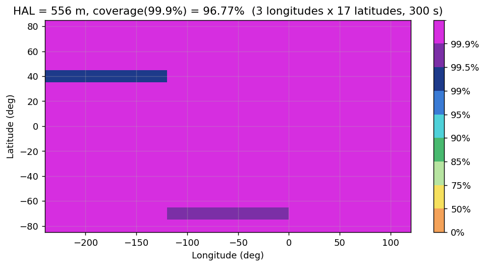
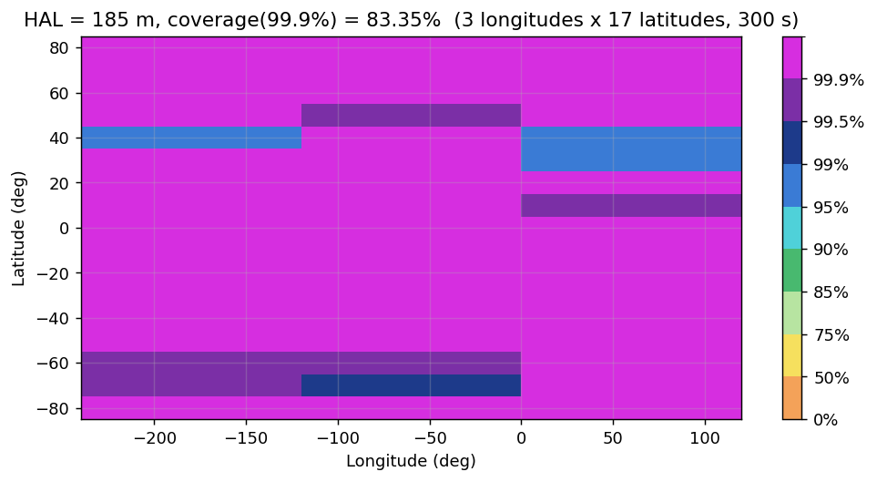

# Validation

All numbers below can be regenerated; the unit tests (`pytest`, 118 tests) assert the first two sections.

## 1. Numerical example of the TAES 2015 paper (Appendix J)

`pyaraim appendix-j` — ten satellites, two constellations, Table II constants, fault detection only.

| | pyaraim | paper |
|---|---:|---:|
| VPL | 19.06 m | 19.10 m |
| HPL | 14.2 m | 14.1 m |
| EMT | 8.30 m | 8.3 m |
| σ_v,acc | 1.470 m | 1.47 m |
| σ_v^(k) of the two constellation modes | 2.5760 / 2.5577 m | 2.5760 / 2.5577 m |
| σ_ss,v^(k) of the two constellation modes | 1.5307 / 1.5292 m | same |
| K_fa,3 for 57 modes | 5.3953 | 5.3953 |

The automatic mode selection yields 67 observable modes (the paper lists 57: it omits the ten "constellation +
one satellite of the other" modes, which leave exactly four satellites). Using the paper's list explicitly
(`FaultModeList.from_masks`) gives VPL = 19.10 m. The residual differences (≤ 0.2 % on VPL, ≈ 1 % on HPL) are
within the bracketing tolerance `TOL_PL = 0.05 m` and the choice of modes.

## 2. Statistical checks

* `verify_mode_bound`: the per-mode bound is not contradicted (99.9 % confidence) for 9 modes × 3 fault sizes
  × 30 000 trials, and is attained within a factor ≈ 4 for the worst fault size (it is tight, not vacuous).
* `false_alert_rate`: empirical 1.3 % against a 4 % union bound (inflated budget, correlated tests).
* χ² threshold: empirical exceedance equals the configured `P_FA` within sampling noise.

## 3. Availability vs. Figure 2 of the ION ITM 2022 paper

Setup of Fig. 1 of the paper: GPS 24 + Galileo 24 (bundled WG-C almanacs), `P_HMI = 1e-7`, `P_FA = 5e-7`,
`P_THRES = 8e-8`, `N_ES = 360`, exposure 1 h, ISD of the paper table, worst-case exclusion HPL, 99.9 % availability.

| Run | HAL 556 m | HAL 185 m |
|---|---:|---:|
| Paper (10°×10° grid, 300 s) | 97.04 % | 78.55 % (76.38 % without reduction) |
| pyaraim, lat −80…80 step 10°, 3 longitudes, 300 s | 96.77 % | 83.35 % |
| pyaraim, lat step 10°, 6 longitudes, 1200 s (coarse) | 100.0 % | 89.8 % |

Interpretation and caveats:

* At HAL 556 m the agreement is within 0.3 percentage points.
* At HAL 185 m the Python result is optimistic by ≈ 5 points. The tail of the distribution is sensitive to (i) the
  user grid (the paper uses the MAAST world polygon, here a regular grid with only three longitudes), (ii) the
  sampling interval (coarser time steps are easier to pass at 99.9 %, as the third row shows), (iii) the user error
  model and the Galileo URE, which the paper does not tabulate (ED-259A and 4 m assumed), and (iv) the epoch of the
  almanac relative to Earth rotation. These were *not* tuned to match the paper.
* A full 10°×10° run (≈ 600 users) is a ≈ 1–2 CPU-hour job: `pyaraim availability --hal 185 --jobs N`.

## 4. What is *not* validated

* No independent comparison against MAAST output on identical inputs was possible in this environment
  (no MATLAB). Use `pyaraim ref-cases` to do it.
* Long-tail behaviour at the real 1e-7 budgets cannot be verified by Monte Carlo; the bounds are verified at
  inflated budgets instead.

## 5. Figures (300 s run of section 3)

